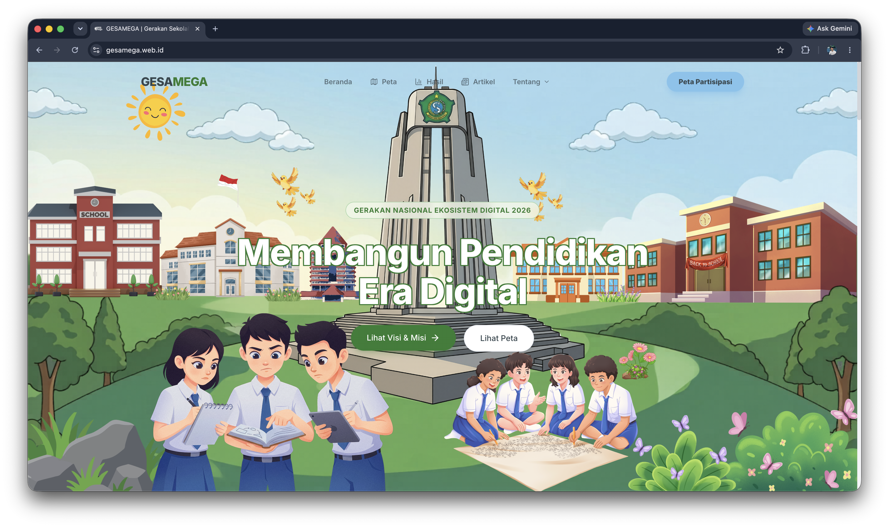

# GESAMEGA - Gerakan Sekolah Bijak Mengelola Gadget

Platform kolaboratif nasional berbasis web untuk mendorong penggunaan gadget yang sehat, terukur, dan berdampak positif pada kualitas pendidikan di sekolah-sekolah Indonesia.

**Tautan Produksi:** [gesamega.web.id](https://gesamega.web.id)

<div align="center">
  
</div>

## Daftar Isi

- [Teknologi yang Digunakan](#teknologi-yang-digunakan)
- [Arsitektur Proyek](#arsitektur-proyek)
- [Struktur Direktori](#struktur-direktori)
- [Skema Basis Data](#skema-basis-data)
- [Fitur Utama](#fitur-utama)
- [Rute API](#rute-api)
- [Autentikasi & Keamanan](#autentikasi--keamanan)
- [Pengaturan & Pengembangan](#pengaturan--pengembangan)
- [Variabel Lingkungan](#variabel-lingkungan)
- [Deployment](#deployment)
- [Performa & Caching](#performa--caching)
- [Catatan & Masalah yang Diketahui](#catatan--masalah-yang-diketahui)

---

## Teknologi yang Digunakan

| Kategori     | Teknologi                                      |
| ------------ | ---------------------------------------------- |
| Framework    | [Next.js 16](https://nextjs.org/) (App Router) |
| Bahasa       | TypeScript 5                                   |
| Basis Data   | [Supabase](https://supabase.com/) (PostgreSQL) |
| Autentikasi  | Supabase Auth                                  |
| CSS          | Tailwind CSS v4                                |
| Animasi      | Framer Motion                                  |
| Peta         | Leaflet + React-Leaflet                        |
| QR Code      | qrcode.react                                   |
| Keamanan     | Google reCAPTCHA v3                            |
| Ikon         | Lucide React                                   |
| PDF          | jsPDF                                          |
| Tanda Tangan | react-signature-canvas                         |
| Panduan      | driver.js                                      |
| Runtime      | Node.js (Vercel Edge-compatible)               |

---

## Arsitektur Proyek

```text
Browser (React Client)
    │
    ├─ Next.js App Router (SSR / ISR / CSR)
    │       │
    │       ├─ src/middleware.ts          ← Penjaga autentikasi (Edge Runtime)
    │       ├─ src/app/(main)/            ← Halaman publik
    │       ├─ src/app/admin/             ← Panel Admin (terlindungi)
    │       └─ src/app/api/               ← Rute API (serverless)
    │
    └─ Supabase (PostgreSQL + Auth + Storage)
            ├─ Anon Key → Halaman publik (RLS diaktifkan)
            └─ Service Role Key → Hanya untuk rute API admin
```

### Pola Rendering per Halaman

| Halaman           | Mode | Revalidasi       |
| ----------------- | ---- | ---------------- |
| `/` (Beranda)     | ISR  | 1 jam            |
| `/kuis`           | CSR  | -                |
| `/survei`         | CSR  | -                |
| `/peta`           | CSR  | -                |
| `/artikel`        | SSR  | Per permintaan   |
| `/artikel/[slug]` | CSR  | -                |
| `/studi-kasus`    | SSR  | Per permintaan   |
| `/hasil`          | CSR  | -                |
| `/admin/*`        | SSR  | `revalidate = 0` |

---

## Struktur Direktori

<details>
<summary>Klik untuk melihat detail struktur direktori</summary>

```text
sosio-web/
├── src/
│   ├── app/
│   │   ├── (main)/                   # Grup rute publik (dengan Navbar + Footer)
│   │   │   ├── page.tsx              # Beranda (ISR)
│   │   │   ├── kuis/page.tsx         # Kuis Refleksi Digital Siswa
│   │   │   ├── survei/               # Survei sekolah
│   │   │   ├── hasil/                # Hasil statistik kuis
│   │   │   ├── peta/                 # Peta sebaran sekolah (Leaflet)
│   │   │   ├── artikel/              # Daftar & detail artikel
│   │   │   ├── studi-kasus/          # Studi kasus sekolah
│   │   │   ├── komitmen/             # Formulir komitmen digital sekolah
│   │   │   ├── tentang/              # Tentang GESAMEGA
│   │   │   ├── tim/                  # Tim
│   │   │   └── visi-misi/            # Visi & Misi
│   │   ├── admin/                    # Panel Admin (terlindungi autentikasi)
│   │   │   ├── layout.tsx            # Tata letak sidebar admin
│   │   │   ├── page.tsx              # Dasbor statistik (Kuis + Survei)
│   │   │   ├── data-kuis/page.tsx    # Tabel data hasil kuis
│   │   │   ├── data-survei/page.tsx  # Tabel data hasil survei instansi
│   │   │   ├── qr-generator/page.tsx # Generator QR Kampanye Kuis
│   │   │   ├── qr-survei/page.tsx    # Generator QR Kampanye Survei
│   │   │   └── login/page.tsx        # Halaman login admin
│   │   ├── api/
│   │   │   ├── questions/route.ts    # GET pertanyaan kuis (di-cache)
│   │   │   ├── submit-quiz/route.ts  # POST pengiriman hasil kuis
│   │   │   ├── admin/
│   │   │   │   ├── qr-campaigns/route.ts  # POST/DELETE kampanye QR
│   │   │   │   ├── qr-stats/route.ts      # GET statistik QR Kuis
│   │   │   │   └── qr-stats-survei/route.ts # GET statistik QR Survei
│   │   ├── actions/
│   │   │   ├── survey.ts             # Server Action: pengiriman survei
│   │   │   └── komitmen.ts           # Server Action: pengiriman komitmen
│   │   ├── layout.tsx                # Tata letak utama (metadata, font)
│   │   ├── robots.ts                 # Konfigurasi robots.txt
│   │   └── sitemap.ts                # Peta situs sitemap.xml
│   ├── components/
│   │   ├── landing/                  # Komponen bagian beranda
│   │   ├── layout/                   # Navbar, Footer
│   │   ├── ui/                       # Komponen UI yang dapat digunakan kembali
│   │   ├── PetaMap.tsx               # Komponen peta Leaflet (impor dinamis)
│   │   ├── SchoolAutocomplete.tsx    # Pencarian otomatis sekolah
│   │   ├── TourGuide.tsx             # Panduan interaktif pengguna (driver.js)
│   │   └── HeroCarousel.tsx          # Korsel bagian hero
│   ├── lib/
│   │   ├── supabase.ts               # Klien anonim Supabase (umum)
│   │   ├── supabase-browser.ts       # Klien peramban Supabase (@supabase/ssr)
│   │   ├── supabase-server.ts        # Klien server Supabase (dengan dukungan kuki)
│   │   ├── supabase-admin.ts         # Klien peran layanan Supabase (hanya server)
│   │   ├── recaptcha.ts              # Verifikasi reCAPTCHA v3 di sisi server
│   │   ├── pdfGenerator.ts           # Pembuat PDF hasil kuis (jsPDF)
│   │   ├── utils.ts                  # Fungsi utilitas pembantu
│   │   ├── repositories/
│   │   │   └── quizRepository.ts     # Lapisan akses data kuis
│   │   └── services/
│   │       └── quizService.ts        # Logika bisnis kuis & penilaian
│   ├── middleware.ts                 # Penjaga autentikasi (Auth guard)
│   └── proxy.ts                      # (DEPRECATED - sudah dihapus)
│
├── supabase/
│   ├── schema.sql                    # Skema DDL lengkap
│   ├── seed.sql                      # Data awal sekolah
│   ├── seed_kuis_siswa.sql           # Pertanyaan & opsi kuis siswa
│   ├── seed_articles.sql             # Data awal artikel
│   └── seed_gesamega.sql             # Data GESAMEGA
├── public/                           # Aset statis
├── next.config.ts                    # Konfigurasi Next.js
├── tsconfig.json                     # Konfigurasi TypeScript
└── .env.local                        # Variabel lingkungan
```

</details>

---

## Skema Basis Data

### ERD Ringkas

```text
schools ──────────┬── survey_results
                  ├── commitments
                  ├── case_studies
                  └── quiz_results ─── quiz_answers ─── question_options ─── questions

articles (berdiri sendiri)
qr_campaigns (berdiri sendiri)
```

### Tabel

#### `schools`

| Kolom              | Tipe        | Keterangan                      |
| ------------------ | ----------- | ------------------------------- |
| `id`               | UUID        | Primary Key                     |
| `nama_sekolah`     | TEXT        | Nama lengkap sekolah            |
| `wilayah`          | TEXT        | Kota/Kabupaten                  |
| `latitude`         | FLOAT       | Koordinat peta                  |
| `longitude`        | FLOAT       | Koordinat peta                  |
| `status`           | ENUM        | `belum` / `survei` / `komitmen` |
| `status_validasi`  | ENUM        | `pending` / `valid` / `flagged` |
| `ip_address`       | TEXT        | IP pengirim (pembatasan laju)   |
| `submit_timestamp` | TIMESTAMPTZ | Waktu pengiriman                |

#### `survey_results`

| Kolom        | Tipe        | Keterangan                           |
| ------------ | ----------- | ------------------------------------ |
| `id`         | UUID        | Primary Key                          |
| `school_id`  | UUID FK     | Referensi ke tabel sekolah           |
| `nama`       | TEXT        | Nama responden instansi              |
| `jawaban`    | JSONB       | Data mentah formulir survei          |
| `source`     | TEXT        | Sumber QR kampanye survei (nullable) |
| `created_at` | TIMESTAMPTZ | Waktu pengiriman                     |

#### `quiz_results`

| Kolom             | Tipe    | Keterangan                                      |
| ----------------- | ------- | ----------------------------------------------- |
| `id`              | UUID    | Primary Key                                     |
| `school_id`       | UUID FK | Referensi ke tabel sekolah (nullable)           |
| `user_name`       | TEXT    | Nama pengisi                                    |
| `answers`         | JSONB   | Array skor mentah                               |
| `result_category` | TEXT    | Kategori hasil (contoh: "Bijak")                |
| `qualification`   | VARCHAR | Sama dengan result_category                     |
| `indicator_color` | VARCHAR | Warna indikator (emerald/teal/amber/orange/red) |
| `description`     | TEXT    | Deskripsi hasil                                 |
| `source`          | TEXT    | Sumber QR kampanye (nullable)                   |

#### `questions` & `question_options`

| Kolom                    | Tipe    | Keterangan                     |
| ------------------------ | ------- | ------------------------------ |
| `questions.category`     | VARCHAR | `"Kuis Siswa"` atau `"Survei"` |
| `question_options.score` | INT     | 1-3 (skor per opsi jawaban)    |

#### `qr_campaigns`

| Kolom    | Tipe        | Keterangan                                |
| -------- | ----------- | ----------------------------------------- |
| `id`     | UUID        | Primary Key                               |
| `name`   | TEXT        | Nama kampanye                             |
| `source` | TEXT UNIQUE | Slug QR (digunakan sebagai parameter URL) |

> **Catatan:** Tabel `qr_campaigns` tidak tersedia di berkas `schema.sql`. Pembuatan dilakukan secara manual melalui SQL Editor Supabase:
>
> ```sql
> ALTER TABLE quiz_results ADD COLUMN IF NOT EXISTS source TEXT DEFAULT NULL;
> ALTER TABLE survey_results ADD COLUMN IF NOT EXISTS source TEXT DEFAULT NULL;
>
> CREATE TABLE IF NOT EXISTS qr_campaigns (
>   id UUID DEFAULT gen_random_uuid() PRIMARY KEY,
>   name TEXT NOT NULL,
>   source TEXT NOT NULL UNIQUE,
>   created_at TIMESTAMPTZ DEFAULT NOW()
> );
> ```

### Indeks (Indexes)

```sql
-- Pencarian teks penuh nama sekolah (trigram)
CREATE INDEX idx_schools_nama_trgm ON schools USING gin (nama_sekolah gin_trgm_ops);

-- Indeks komposit untuk dasbor dan peta
CREATE INDEX idx_schools_status_validation ON schools(status, status_validasi);

-- Indeks Foreign Key
CREATE INDEX idx_survey_results_school_id ON survey_results(school_id);
CREATE INDEX idx_quiz_results_school_id ON quiz_results(school_id);
```

---

## Fitur Utama

### 1. Kuis Refleksi Digital (`/kuis`)

- **Akses Tersembunyi Berdasarkan Desain:** Halaman hanya dapat dibuka melalui parameter `?source=slug` dari pemindaian kode QR. Akses langsung diblokir (Kesalahan 404).
- **Alur Pengguna:** Registrasi (nama dan sekolah) dilanjutkan dengan menjawab pertanyaan, dan diakhiri dengan halaman hasil beserta kategori.
- **Sistem Penilaian:** Akumulasi skor dari `question_options.score` (1-3 per soal).
- **Kategori Hasil:**

  | Rentang Skor | Kategori           | Warna   |
  | ------------ | ------------------ | ------- |
  | ≥ 60         | Sangat Bijak       | Emerald |
  | 50-59        | Bijak              | Teal    |
  | 38-49        | Cukup Bijak        | Amber   |
  | 25-37        | Perlu Pendampingan | Orange  |
  | < 25         | Darurat Digital    | Red     |

- **Pencegahan Duplikasi Ketat:** Penyimpanan lokal browser mencatat status penyelesaian `kuis_completed = true`. Pengisian ulang dari perangkat yang sama diblokir secara penuh.
- **Keamanan:** Memanfaatkan reCAPTCHA v3 dengan mekanisme pengulangan hingga tiga kali untuk mengatasi masalah inisialisasi waktu.

### 2. Survei Sekolah (`/survei`)

- **Akses Tersembunyi Berdasarkan Desain:** Hanya dapat diakses melalui tautan QR kampanye (`?source=slug`).
- Data formulir JSONB disimpan di kolom `survey_results.jawaban`.
- **Pelacakan Sumber QR:** Data kampanye direkam langsung ke `survey_results.source` secara terstandardisasi.
- **Pencegahan Duplikasi Ketat:** Penyimpanan lokal mencatat status penyelesaian `survei_completed = true` setelah keberhasilan pengiriman.
- Validasi instansi: Hanya sekolah yang terdaftar di basis data yang diizinkan mengirimkan survei.
- Status sekolah secara otomatis diperbarui dari `belum` menjadi `survei`.

### 3. Komitmen Digital (`/komitmen`)

- Implementasi tanda tangan digital menggunakan pustaka `react-signature-canvas`, dengan penyimpanan pada Supabase Storage.
- Pengiriman formulir mengubah atribut status `schools.status` menjadi `komitmen` dan memvalidasi entri.

### 4. Peta Sebaran (`/peta`)

- Menggunakan peta Leaflet dengan penanda warna yang merepresentasikan status (belum/survei/komitmen).
- **Eksklusivitas Panggilan Aksi (CTA):** Tombol menuju halaman `/komitmen` hanya muncul saat pengunjung dialihkan secara otomatis pasca-penyelesaian survei. Pengunjung umum tidak diberikan akses visibilitas terhadap CTA ini.
- Implementasi impor dinamis guna mencegah kesalahan Server-Side Rendering (SSR) pada komponen Leaflet.

### 5. Pembuat Kode QR (Admin)

- Fasilitas pembuatan kampanye QR terpisah untuk **Kuis Siswa** dan **Survei Instansi**.
- Penambahan awalan otomatis `survei-` untuk memisahkan jalur pelacakan data.
- Kemampuan mengunduh kode QR dalam format gambar PNG dengan rancangan yang disesuaikan.
- Representasi statistik peserta per kampanye yang ditampilkan secara seketika (real-time).

### 6. Panel Admin (`/admin`)

- **Antarmuka Pengguna Modern:** Struktur navigasi dikelompokkan secara visual untuk mengoptimalkan pengalaman pengguna (Gambaran Umum, Kuis Siswa, Survei Instansi).
- **Dasbor Utama:** Menyediakan metrik analitik tingkat tinggi mengenai tingkat partisipasi kuis dan survei.
- **Data Kuis & Survei:** Tabel pemantauan data spesifik untuk masing-masing tipe kuesioner.
- **QR Kuis & Survei:** Antarmuka pembuat kode QR khusus untuk mendukung kampanye pengguna.

---

## Rute API

### API Publik

#### `GET /api/questions`

Mendapatkan daftar pertanyaan kuis yang tersedia.

**Parameter Kueri:**
| Parameter | Nilai Baku | Keterangan |
|-----------|------------|------------|
| `category`| - | Filter kategori (misal: `Kuis%20Siswa`) |

**Contoh Respons:**

```json
{
  "success": true,
  "data": [
    {
      "id": 101,
      "question_text": "...",
      "category": "Kuis Siswa",
      "question_options": [
        { "id": 1, "option_text": "...", "score": 1, "question_id": 101 }
      ]
    }
  ]
}
```

**Konfigurasi Cache:** `Cache-Control: public, s-maxage=3600, stale-while-revalidate=3600`

---

#### `POST /api/submit-quiz`

Merekam hasil kuis peserta ke dalam basis data.

**Badan Permintaan (Request Body):**

```json
{
  "user_name": "Budi",
  "school_id": "uuid-sekolah",
  "answers": [{ "question_id": 101, "option_id": 1, "score": 2 }],
  "source": "sman_4_sidoarjo",
  "captchaToken": "token-dari-recaptcha-v3"
}
```

**Contoh Respons:**

```json
{
  "success": true,
  "data": {
    "totalScore": 52,
    "category": "Bijak",
    "indicator_color": "teal",
    "description": "...",
    "motivation_message": "..."
  }
}
```

**Keamanan:** Melakukan verifikasi reCAPTCHA v3 (skor minimal 0.5) sebelum eksekusi penyimpanan.

---

### API Admin (Membutuhkan Autentikasi)

Seluruh rute pada direktori `/api/admin/*` dilindungi oleh middleware keamanan. Permintaan tanpa sesi yang valid akan ditolak dengan status kode `401 Unauthorized`.

#### `GET /api/admin/qr-stats`

Menampilkan statistik komprehensif kampanye QR dan metrik partisipasi.

**Pendekatan Teknis:** Mengeksekusi 2 kueri paralel untuk optimalisasi performa.

1. Mengambil seluruh data `qr_campaigns`
2. Mengambil seluruh data `quiz_results.source` yang memiliki nilai
3. Melakukan perhitungan jumlah partisipan pada memori sistem dengan struktur data `Map`

#### `POST /api/admin/qr-campaigns`

Membuat entri kampanye QR baru.

```json
{ "name": "SMAN 4 Sidoarjo", "source": "sman_4_sidoarjo" }
```

#### `DELETE /api/admin/qr-campaigns?id={uuid}`

Menghapus kampanye QR spesifik berdasarkan parameter ID.

---

## Autentikasi & Keamanan

### Penjaga Autentikasi (`src/middleware.ts`)

```text
Aturan Pencocokan: ["/admin/:path*", "/api/admin/:path*"]
```

**Mekanisme:**

1. Seluruh permintaan HTTP menuju `/admin/*` atau `/api/admin/*` ditangkap oleh middleware.
2. Melakukan pembaruan sesi Supabase melalui kuki.
3. Apabila sesi pengguna tidak terdeteksi:
   - Akses Halaman akan dialihkan menuju `/admin/login`
   - Akses API akan mengembalikan respons `401 { success: false, error: "Unauthorized" }`
4. Apabila pengguna sudah terautentikasi dan mengakses `/admin/login`, sistem akan mengalihkan pengguna kembali ke dasbor utama `/admin`.

> **PENTING:** Middleware hanya berjalan jika berkas bernama `middleware.ts` dan berada di direktori `src/`. Berkas `proxy.ts` tidak akan dieksekusi oleh Next.js.

### Strategi Klien Supabase

| Klien          | Berkas                | Lingkup Penggunaan                 | Kunci Akses        |
| -------------- | --------------------- | ---------------------------------- | ------------------ |
| Klien Anonim   | `supabase.ts`         | Komponen Server, Aksi Server       | `ANON_KEY`         |
| Klien Peramban | `supabase-browser.ts` | Komponen Klien (Autentikasi)       | `ANON_KEY`         |
| Klien Server   | `supabase-server.ts`  | Middleware, Komponen Server (Sesi) | `ANON_KEY`         |
| Klien Admin    | `supabase-admin.ts`   | Hanya pada Rute API Admin          | `SERVICE_ROLE_KEY` |

> **PERINGATAN:** Jangan mengekspos `SERVICE_ROLE_KEY` ke sisi klien. Kunci akses ini akan melewati seluruh lapis keamanan Row Level Security (RLS).

### Google reCAPTCHA v3

Verifikasi keamanan dijalankan pada sisi server melalui:

- Rute `POST /api/submit-quiz` (Pengiriman kuis)
- Aksi Server `submitSurvey` (Pengiriman survei)
- Aksi Server `submitKomitmen` (Pengiriman komitmen)

Batas ambang skor minimal adalah **0.5**. Permintaan akan ditolak jika skor berada di bawah batas tersebut.

---

## Pengaturan & Pengembangan

### Prasyarat

- Node.js versi 18 atau lebih baru
- npm versi 9 atau lebih baru
- Akun [Supabase](https://supabase.com)
- Akun [Google reCAPTCHA v3](https://www.google.com/recaptcha/admin)

### Langkah Persiapan Lingkungan

```bash
# 1. Klon repositori
git clone https://github.com/your-org/sosio-web.git
cd sosio-web

# 2. Instalasi dependensi
npm install

# 3. Konfigurasi variabel lingkungan
cp .env.example .env.local
# Lakukan konfigurasi .env.local sesuai dengan bagian Variabel Lingkungan di bawah

# 4. Pengaturan basis data Supabase
# Akses Dasbor Supabase -> SQL Editor
# Jalankan skrip berkas secara berurutan:
# 1. supabase/schema.sql
# 2. supabase/seed.sql
# 3. supabase/seed_kuis_siswa.sql
# 4. supabase/seed_articles.sql (Opsional)
# 5. Eksekusi skrip tambahan qr_campaigns (lihat bagian Skema Basis Data)

# 5. Jalankan peladen (server) pengembangan lokal
npm run dev
```

Peladen pengembangan dapat diakses melalui tautan [http://localhost:3000](http://localhost:3000).

> **Catatan:** Fitur reCAPTCHA v3 tidak akan berfungsi secara penuh pada domain `localhost` secara bawaan. Anda perlu mendaftarkan domain `localhost` ke daftar domain yang diizinkan pada konsol administrasi reCAPTCHA.

### Pembuatan Versi Produksi (Build)

```bash
npm run build
npm run start
```

---

## Variabel Lingkungan

Buat berkas `.env.local` pada direktori root proyek:

```env
# Supabase
NEXT_PUBLIC_SUPABASE_URL=https://xxxxxxxxxxxx.supabase.co
NEXT_PUBLIC_SUPABASE_ANON_KEY=eyJhbGci...

# Supabase Service Role (RAHASIA - Hanya untuk server, jangan ekspor ke klien!)
SUPABASE_SERVICE_ROLE_KEY=eyJhbGci...

# Google reCAPTCHA v3
NEXT_PUBLIC_RECAPTCHA_SITE_KEY=6Lxxxxxxxxxxxxxxxx
RECAPTCHA_SECRET_KEY=6Lxxxxxxxxxxxxxxxx
```

| Variabel                         | Hak Akses       | Keterangan                              |
| -------------------------------- | --------------- | --------------------------------------- |
| `NEXT_PUBLIC_SUPABASE_URL`       | Publik          | Tautan utama proyek Supabase            |
| `NEXT_PUBLIC_SUPABASE_ANON_KEY`  | Publik          | Kunci anonim publik (dilindungi RLS)    |
| `SUPABASE_SERVICE_ROLE_KEY`      | **Server saja** | Melewati RLS (Hanya untuk API admin)    |
| `NEXT_PUBLIC_RECAPTCHA_SITE_KEY` | Publik          | Kunci situs reCAPTCHA (Untuk antarmuka) |
| `RECAPTCHA_SECRET_KEY`           | **Server saja** | Kunci rahasia reCAPTCHA (Verifikasi)    |

---

## Deployment

### Vercel (Rekomendasi Utama)

1. Lakukan pembaruan kode ke repositori GitHub.
2. Impor proyek pada platform [vercel.com](https://vercel.com).
3. Atur variabel lingkungan pada menu Pengaturan (Settings) -> Variabel Lingkungan (Environment Variables).
4. Pembaruan akan diterapkan secara otomatis saat terjadi dorongan (push) pada cabang `main`.

**Konfigurasi Domain Khusus:**

- Tetapkan domain `gesamega.web.id` pada bagian Domain di panel kontrol Vercel.
- Pastikan pencatatan DNS (DNS Record) mengarah ke server Vercel.

**Konfigurasi Tambahan reCAPTCHA:**

- Tambahkan domain `gesamega.web.id` ke dalam daftar domain yang diizinkan pada Konsol Admin Google reCAPTCHA.

### Konfigurasi next.config.ts

```ts
const nextConfig: NextConfig = {
  allowedDevOrigins: ["192.168.x.x"], // Alamat IP lokal untuk pengujian perangkat genggam
};
```

---

## Performa & Caching

### Strategi Penyimpanan Sementara (Cache)

| Titik Akhir / Halaman      | Metode Cache            | Durasi Berlaku (TTL) |
| -------------------------- | ----------------------- | -------------------- |
| `GET /api/questions`       | CDN (`s-maxage`)        | 1 jam + 1 jam SWR    |
| `/` (Beranda)              | ISR Next.js             | 1 jam                |
| `/admin/*`                 | Tanpa Cache             | -                    |
| `/artikel`, `/studi-kasus` | SSR (Setiap permintaan) | -                    |

### Optimalisasi Kueri Basis Data

| Komponen Sistem   | Pendekatan Teknis                      |
| ----------------- | -------------------------------------- |
| Dasbor Admin      | 1 kueri agregat, pemrosesan di JS      |
| Data Kuis         | Pemilihan kolom spesifik + batas (200) |
| Statistik QR      | 2 kueri eksekusi paralel               |
| Halaman Beranda   | Pengambilan data asinkron paralel      |
| Pencarian Sekolah | Pemanfaatan indeks GIN trigram         |

### Pola Arsitektur Lapisan Logika Bisnis (Quiz)

```text
API Route (/api/submit-quiz)
    └─ quizService.submitQuiz()      ← Logika bisnis, penilaian akhir
           └─ quizRepository.saveQuizResult()  ← Lapisan akses data (Data Access Layer)
                   └─ supabase.from("quiz_results").insert(...)
```

---

## Catatan & Masalah yang Diketahui

- **Aktivitas reCAPTCHA pada Localhost:** Proses submisi dapat mengalami kegagalan pada lingkungan pengembangan jika domain `localhost` tidak didaftarkan pada konsol Google. Hal ini adalah fungsi perilaku standar dan tidak memengaruhi kinerja pada peladen produksi.
- **Peringatan Hidrasi (Hydration Warning):** Ekstensi peramban pihak ketiga (seperti ekstensi terjemahan atau pemblokir iklan) dapat memicu peringatan ketidakcocokan hidrasi pada Next.js. Hal ini tidak mengindikasikan kerusakan aplikasi.
- **Halaman Artikel Dinamis:** Halaman detail `artikel/[slug]` saat ini mengimplementasikan CSR (`"use client"`). Proses konversi menuju Komponen Server sedang dikaji untuk optimalisasi indeks mesin pencari (SEO).
- **Tabel `qr_campaigns`:** Konstruksi tabel ini tidak termasuk ke dalam cetak biru `schema.sql` dan memerlukan pembuatan manual pada panel Editor SQL Supabase sesuai dengan instruksi.
